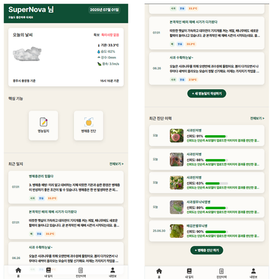
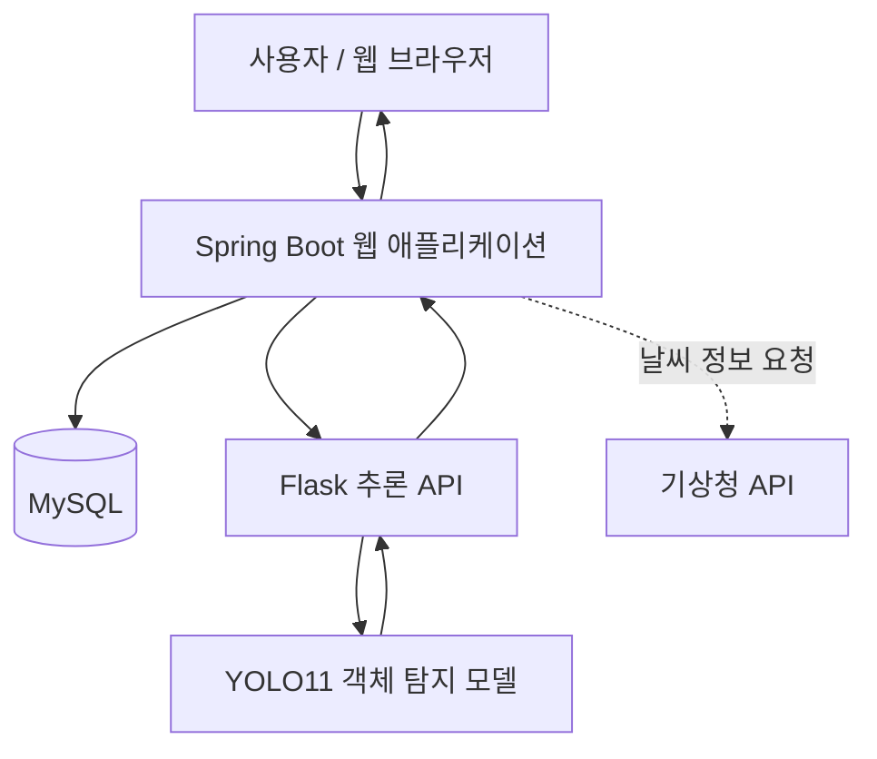
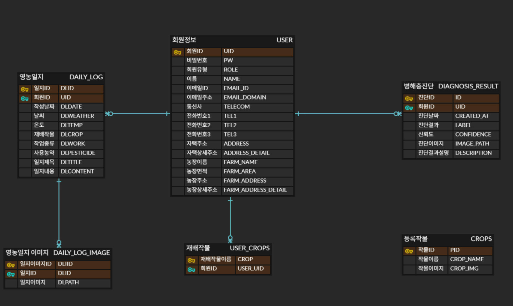

# 📒 PROJECT PRAIME | 농업을 담다

> **영농일지 간편 작성 및 사과·배 병해 AI 진단 플랫폼**  
> Spring Boot 기반 영농일지 관리 서비스와 YOLO11 객체 탐지 모델을 Flask API로 연동한 **4인 팀 프로젝트**입니다.

<!-- TODO: 실제 서비스가 운영 중인 경우에만 URL을 연결하세요. -->
**~~[🌐 서비스 페이지](#) : 데모종료~~** 

 **[🤖 Flask 저장소](https://github.com/2025-SMHRD-SW-LangIntelligence/PRAIME-Flask)**

---

## 🖼️ 주제

**농업을 담다(PRAIME)** 는 친환경 인증 농가의 영농일지 작성 부담을 줄이고, 과수 이미지 기반 병해 진단을 지원하기 위해 개발한 웹앱 플랫폼입니다.

- **영농일지:** 사용자별 작물 및 영농 작업을 기록·조회·수정·삭제하고 이미지를 함께 관리
- **AI 병해 진단:** 업로드한 사과·배 관련 이미지에 YOLO11 기반 객체 탐지를 적용하고 진단 결과와 이력을 제공
- **정보 연계:** 기상청 API를 활용한 날씨 정보 조회 및 최근 기록 접근

### 📰 서비스 목표

1. 영농일지 작성·관리 과정을 간편하게 만들어 기록 편의성 향상
2. 이미지 기반 병해 진단을 통해 빠른 이상 징후 확인 지원
3. 영농일지와 AI 진단 이력을 하나의 웹서비스에서 통합 관리

---

## ⚙ 개발환경

## 🛠 사용기술

| 구분 | 기술 |
|---|---|
| **Backend** | Java, Spring Boot, Spring Data JPA, REST API |
| **AI / ML** | Python, PyTorch, YOLO11 |
| **AI Serving** | Flask |
| **Frontend** | HTML, CSS, JavaScript, Thymeleaf, jQuery, Axios |
| **Database** | MySQL |
| **Tools / Collaboration** | GitHub, Postman, Figma, AI Station |

---

## 📅 개발기간 및 팀 구성

| 항목 | 내용 |
|---|---|
| **개발 기간** | **2025.06.13 ~ 2025.06.26** |
| **참여 인원** | 이은석, 이현희, 김현수, 고해석 |
| **프로젝트 형태** | 팀 프로젝트 |
| **구성** | Spring Boot 웹서비스 + Flask AI 추론 서버 |

---

## 🎢 개발 플로우차트

### 시스템 아키텍처

#### 메뉴트리

- 사용자: 회원가입 / 로그인
- 메인: 날씨 정보 / 핵심 기능 바로가기 / 최근 영농일지 / 최근 진단 이력
- 영농일지: 작성 / 목록 / 상세보기 / 수정 / 삭제
- AI 병해 진단: 이미지 업로드 및 진단 / 결과 조회 / 진단 이력 / 삭제

#### 기능정의

| 기능 | 설명 |
|---|---|
| 회원관리 | 회원가입·로그인, 가입 시 작물 정보 선택 |
| 메인 대시보드 | 기상청 API 기반 날씨, 최근 기록 및 진단 내역 표시 |
| 영농일지 | 작물 연계, 다중 이미지 업로드, 작성·조회·수정·삭제, 검색·정렬 |
| AI 진단 | 이미지 업로드, YOLO11 객체 탐지, 결과 저장 |
| 진단 이력 | 비동기 목록 조회, 이미지 상세 모달, 결과 삭제 |

#### ERD

---

## 🧩 주요 기능 

### 1. 메인 

- 로그인 이후 대시보드 진입
- 기상청 API를 통한 날씨 정보 표시
- 영농일지·AI 진단 바로가기 제공
- 최근 영농일지 및 최근 진단 목록 조회
- 하단 내비게이션을 통한 주요 기능 이동

### 2. 영농일지 관리

- 회원가입 시 선택한 작물 정보를 DB에서 불러와 작성 화면에 반영
- `Multipart` 기반 다중 이미지 업로드
- 사용자별 영농일지 작성·목록·상세보기·수정·삭제
- 검색·정렬 기능과 비동기 UI 처리
- 이미지 모달 상세보기 및 삭제

### 3. AI 병해 진단 및 이력

- 사용자가 업로드한 이미지에 대해 YOLO11 객체 탐지 수행
- Spring Boot와 Flask 서버 사이 REST API 통신
- 진단 결과를 DB에 저장하고 이력 목록 제공
- Axios 기반 비동기 페이지네이션 및 무한 스크롤
- 결과 이미지 모달 상세보기 및 진단 이력 삭제

---

###  구현 범위

- **웹서비스:** 회원 관리, 대시보드, 영농일지 CRUD, 이미지 업로드, 검색 및 정렬
- **AI 서비스:** 데이터셋 준비, YOLO11 학습, Flask 추론 API와 웹서비스 연계
- **사용자 경험:** 반응형 여부는 확인 필요, 이미지 모달, 비동기 목록 조회 및 삭제
- **협업:** GitHub 브랜치 기반 기능 개발 및 병합, Postman 테스트

---

## 🤖 AI 모델 학습 및 연동

### 데이터 전처리

1. AI Hub의 과수화상병 객체 탐지 데이터셋 수집
2. 데이터셋을 YOLO11 학습 디렉터리 구조에 맞춰 재구성
3. JSON 어노테이션에서 클래스 및 바운딩 박스 추출 후 TXT 형식으로 변환
4. 전처리 파일을 AI Station GPU 환경에 업로드

### 모델 학습

| 항목 | 설정 |
|---|---|
| 모델 | YOLO11 |
| 프레임워크 | PyTorch |
| Epochs | 120 |
| Batch size | 20 |
| 이미지 크기 | 640 × 640 |
| 학습 환경 | AI Station GPU 서버 |
| 평가 지표(mAP, Precision, Recall) | mAP@0.5 0.80+ |

### 추론 서비스 연동

- 학습된 객체 탐지 모델을 Flask 서버에 연결
- Postman을 이용해 API 통신 점검
- Spring Boot에서 Flask의 추론 결과를 받아 서비스 화면과 진단 이력에 연계

---

## 🧯 트러블 슈팅

### JSON → YOLO TXT 변환 과정의 클래스 라벨 불일치

**문제 상황**

- 기존 JSON 어노테이션을 YOLO 형식으로 변환하면서 사과·배의 **정상 클래스**를 서로 다르게 구분하고자 했습니다.
- 파일명에서 추출한 작물 구분 값과 JSON 내부 `disease` 클래스 정보가 일치하지 않아 변환 과정에서 오류가 발생했습니다.

**원인 분석**

- 파일명에 포함된 작물 구분 정보와 내부 어노테이션의 질병 클래스 정보가 서로 다른 기준을 사용하고 있었습니다.
- 기존 정상 클래스 값을 작물별 정상 클래스로 분리하는 과정에서 라벨 매핑의 일관성이 깨졌습니다.

**해결 방법**

- 작물 분류 및 정상 클래스 처리에 필요한 라벨 전처리를 분리했습니다.
- 변환 규칙에 맞춰 라벨 데이터를 다시 구성하는 방식을 선택했습니다.
---

## 🔔 컨벤션 규칙

<strong>📌 Git 개발 컨벤션</strong>

1. 개발 시작 전 원격 저장소의 최신 변경 사항을 확인합니다.
2. 기능별 브랜치에서 작업하고 커밋을 남깁니다.
3. Push 전에 원격 변경 사항을 확인하고 충돌을 해결합니다.
4. 기능 통합 시 브랜치 간 Merge를 진행합니다.

<strong>📌 커밋 컨벤션</strong>

| Type | 설명 | 예시 |
|---|---|---|
| `Build` | 프로젝트 생성·빌드 | `Build: Spring Boot 프로젝트 생성` |
| `Config` | 환경 설정 | `Config: DB 연결 설정` |
| `Docs` | 문서 작성·수정 | `Docs: README 수정` |
| `Feat` | 기능 추가 | `Feat: 회원가입 기능 구현` |
| `Feat/Tiny` | 소규모 기능 변경 | `Feat/Tiny: 회원 DTO 필드 수정` |
| `Delete` | 기능·파일 삭제 | `Delete: 미사용 필드 삭제` |
| `Design` | 화면 스타일 변경 | `Design: 메인 페이지 CSS 수정` |
| `Rename` | 파일·폴더 이름 변경 | `Rename: index.html 파일명 변경` |
| `Test` | 테스트 코드·API 테스트 | `Test: 진단 API 응답 확인` |
| `Refactor` | 리팩터링 | `Refactor: 영농일지 서비스 구조 개선` |
| `Fix` | 버그 수정 | `Fix: 이미지 삭제 오류 수정` |
| `Extra` | 그 밖의 작업 | `Extra: 개발 문서 정리` |

> 기존 프로젝트의 커밋 명명 규칙을 문서화한 항목으로, 실제 커밋 이력과 완전히 일치하는지는 별도 확인이 필요합니다.

---

## 📈 브랜치 정보

- `master` — 기준 브랜치
- `dev` — 기능 통합 브랜치
- `feature` — 기능 개발 브랜치

